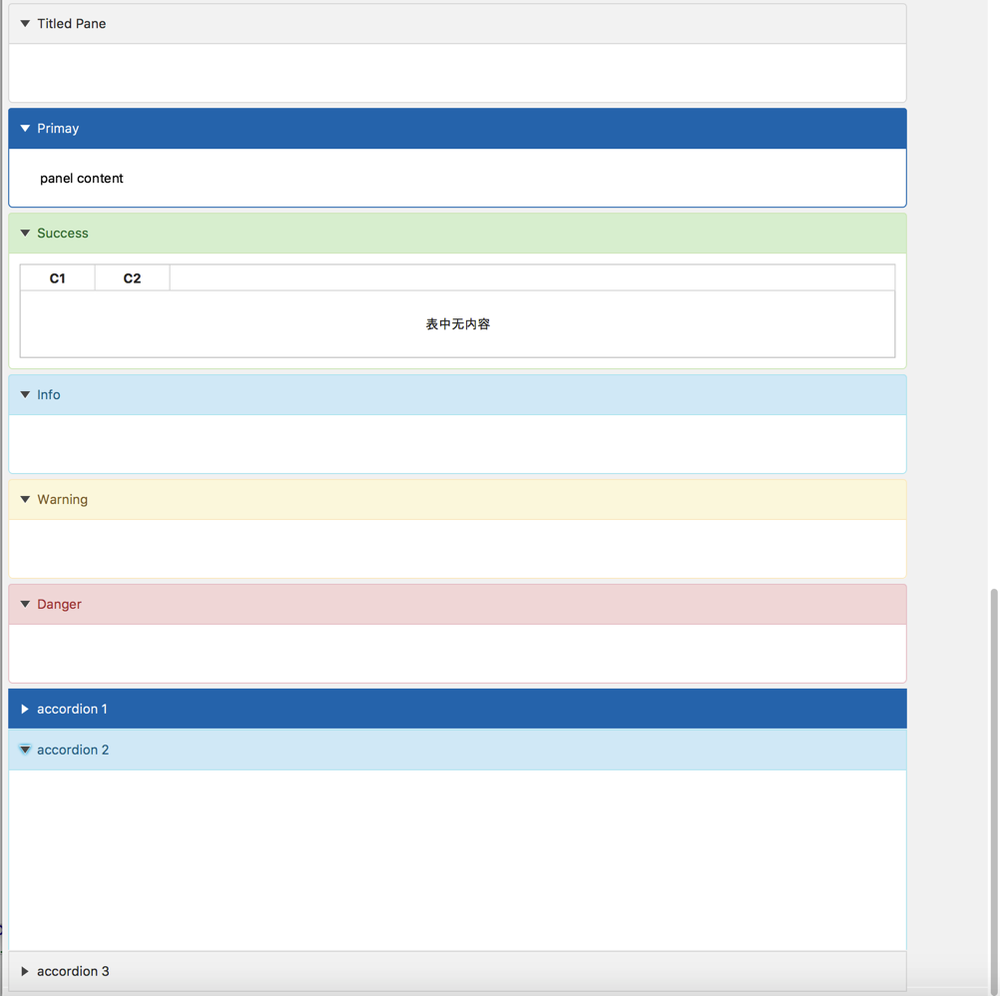

# jbootx

[](https://central.sonatype.com/artifact/io.github.dicolar/jbootx)
[](LICENSE)

Bootstrap themes for JavaFX.

Tired of the default Modena look? jbootx restyles the standard JavaFX controls after Bootstrap 3 or Bootstrap 2,
and it is just a stylesheet: add one CSS file to your scene, no code changes needed.


## Installation

Maven:

```xml
<dependency>
    <groupId>io.github.dicolar</groupId>
    <artifactId>jbootx</artifactId>
    <version>1.0.0</version>
</dependency>
```

Gradle:

```kotlin
implementation("io.github.dicolar:jbootx:1.0.0")
```

JavaFX itself is not pulled in, keep your own `javafx-controls` / `javafx-fxml` dependency.

**Requirements**

- The Maven artifact needs Java 21 and JavaFX 21 or newer.
- On an older Java? Copy `bootstrap3.css` or `bootstrap2.css` from [`src/main/resources`](src/main/resources) into
  your project instead, the stylesheets work on Java 8 and above.
- Stay on the default Modena user agent stylesheet, do not switch to Caspian.

## Quick start

Both stylesheets sit at the root of the jar. Add one of them to your scene:

```java
scene.getStylesheets().add(MyApp.class.getResource("/bootstrap3.css").toExternalForm());
```

A complete example in Java:

```java
public class HelloJBootX extends Application {

    @Override
    public void start(Stage stage) {
        Button save = new Button("Save");
        save.getStyleClass().addAll("primary", "lg");

        Button delete = new Button("Delete");
        delete.getStyleClass().add("danger");

        // a button group: first / middle / last
        Button left = new Button("Left");
        left.getStyleClass().add("first");
        Button middle = new Button("Middle");
        middle.getStyleClass().add("middle");
        Button right = new Button("Right");
        right.getStyleClass().add("last");
        HBox group = new HBox(left, middle, right);

        ProgressBar progress = new ProgressBar(0.6);
        progress.getStyleClass().add("success");

        VBox root = new VBox(12, new TextField(), new HBox(8, save, delete), group, progress);
        root.setPadding(new Insets(16));

        Scene scene = new Scene(root, 480, 320);
        scene.getStylesheets().add(HelloJBootX.class.getResource("/bootstrap3.css").toExternalForm());

        stage.setTitle("jbootx");
        stage.setScene(scene);
        stage.show();
    }

    public static void main(String[] args) {
        launch(args);
    }
}
```

The same in Kotlin:

```kotlin
class HelloJBootX : Application() {
    override fun start(stage: Stage) {
        val save = Button("Save").apply { styleClass += listOf("primary", "lg") }
        val cancel = Button("Cancel")

        val root = VBox(12.0, HBox(8.0, save, cancel)).apply { padding = Insets(16.0) }
        stage.scene = Scene(root, 480.0, 320.0).apply {
            stylesheets += HelloJBootX::class.java.getResource("/bootstrap3.css")!!.toExternalForm()
        }
        stage.show()
    }
}
```

## Style classes

Every standard control is restyled automatically. On top of that, add these style classes for Bootstrap's variants.

| Style class | Applies to | Effect |
|---|---|---|
| `primary` `success` `info` `warning` `danger` | `Button`, `ToggleButton`, `MenuButton`, `SplitMenuButton` | Bootstrap color variants, a button without one looks like Bootstrap's default button |
| `primary` `success` `info` `warning` `danger` | `ProgressBar`, `TitledPane`, `Tooltip` | Colored bar / header / tooltip |
| `lg` `sm` `xs` | buttons, text fields | Large, small and extra small sizes |
| `first` `middle` `last` | buttons and text fields inside an `HBox` or `VBox` | Joined group with rounded outer corners only |
| `action-btn` | buttons | Minimum width of 80, for dialog buttons |
| `plain` | `TabPane` | Tabs without the header background |

In FXML:

```xml
<HBox spacing="8">
    <Button text="Save" styleClass="primary, lg"/>
    <Button text="Cancel"/>
</HBox>

<HBox>
    <Button text="Left" styleClass="first"/>
    <Button text="Middle" styleClass="middle"/>
    <Button text="Right" styleClass="last"/>
</HBox>

<TitledPane text="Notice" styleClass="warning">
    <Label text="Something needs your attention."/>
</TitledPane>

<ProgressBar progress="0.6" styleClass="success"/>
```

## Themes

### Bootstrap 3 (`bootstrap3.css`)




### Bootstrap 2 (`bootstrap2.css`)


Every control and style class is shown in
[`bootstrap3overview.fxml`](src/test/resources/bootstrap3overview.fxml) and
[`bootstrap2overview.fxml`](src/test/resources/bootstrap2overview.fxml). Open them in Scene Builder, or run the demo:

```bash
mvn test -Dtest=JBootXTests#testBootstrap3
```

## FXML helpers (optional)

The jar also ships a few small helpers in `org.alfalfa.fx.core` for loading FXML windows with a theme applied.
Your controller extends `AbstractController` to get access to its `Stage`:

```java
public class MainController extends AbstractController {
}
```

```java
public class MyApp extends Application {

    @Override
    public void start(Stage stage) {
        Scenes scenes = new Scenes.Builder()
                .theme(Scenes.ThemeEnum.BOOTSTRAP3)
                .build();

        // loads main.fxml next to MyApp.class, its fx:controller must extend AbstractController
        Windows.INSTANCE.<MainController>create(scenes, FXLoader.INSTANCE.load(MyApp.class, "main"), stage)
                .windowTitle("jbootx")
                .size(800, 600)
                .show();
    }
}
```

`WindowStub` also offers `modal()`, `wmodal()`, `resizable(...)`, `style(...)`, `icon(...)` and `showAndWait()`.

> In 1.0.0, `Scenes.Builder` can only be used from Java. Kotlin access comes with the next release.

## License

[Apache License 2.0](LICENSE)
