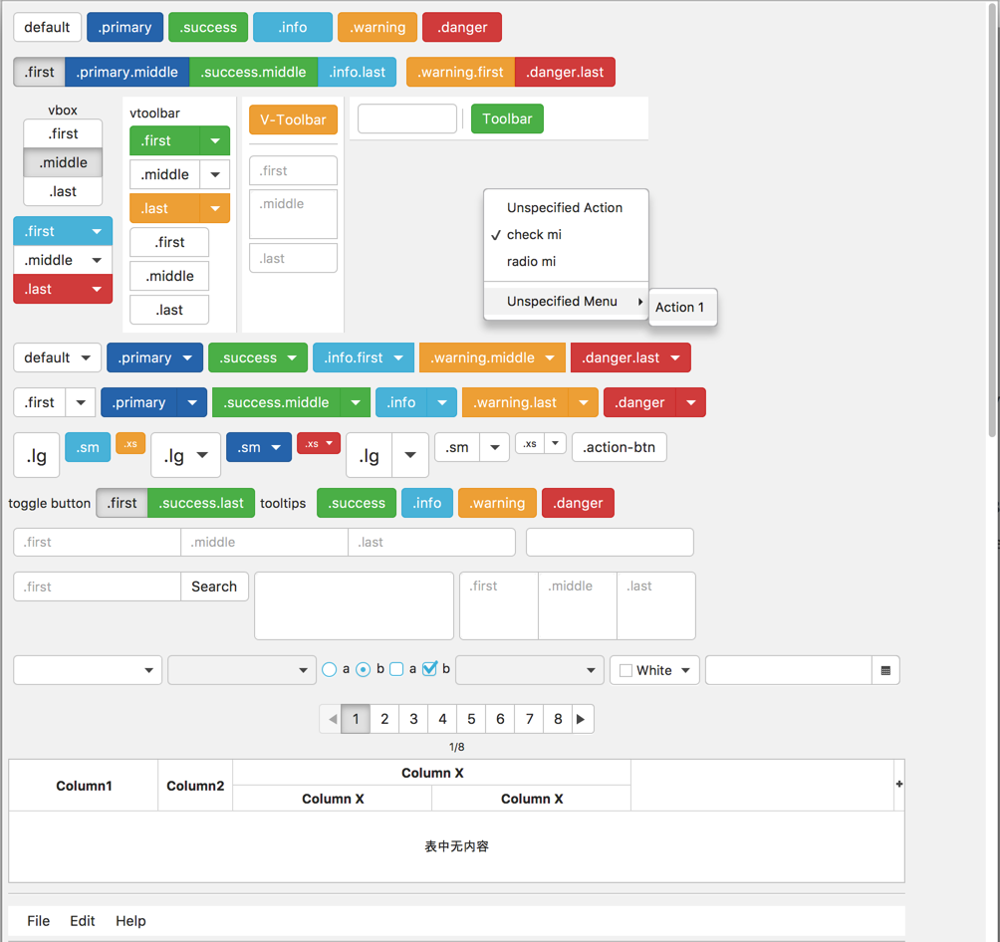
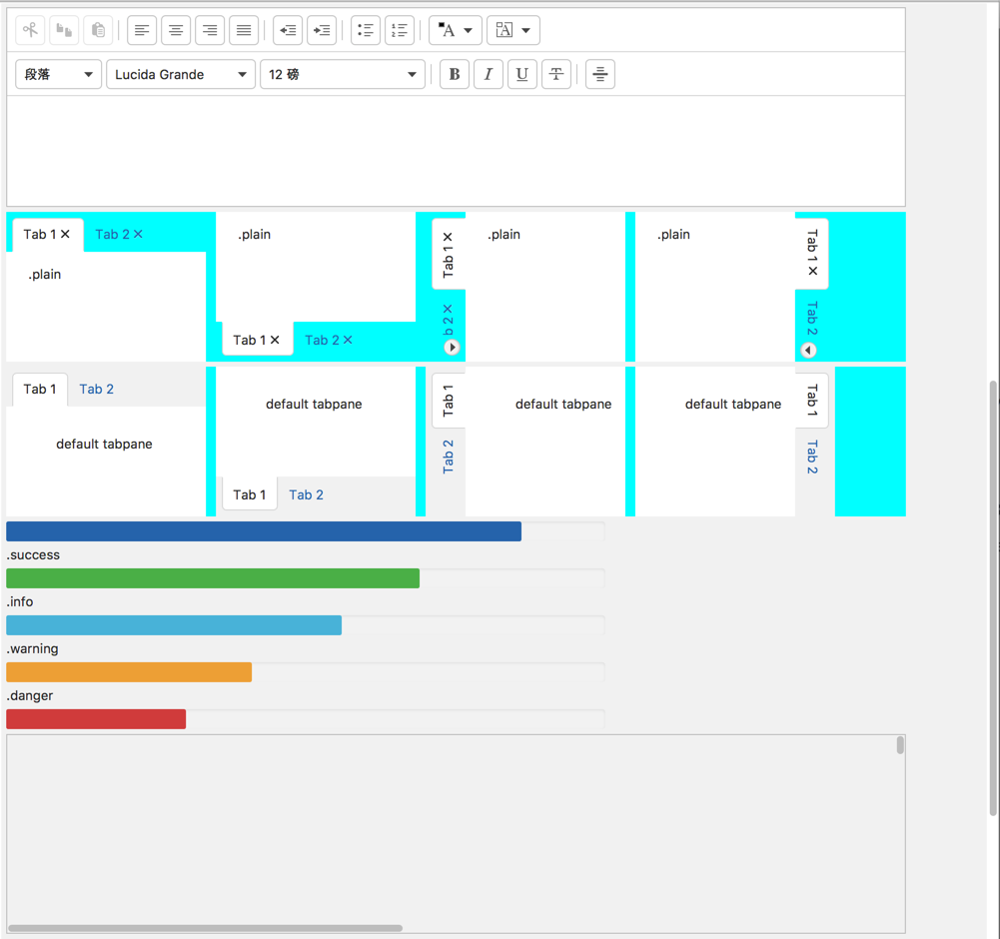
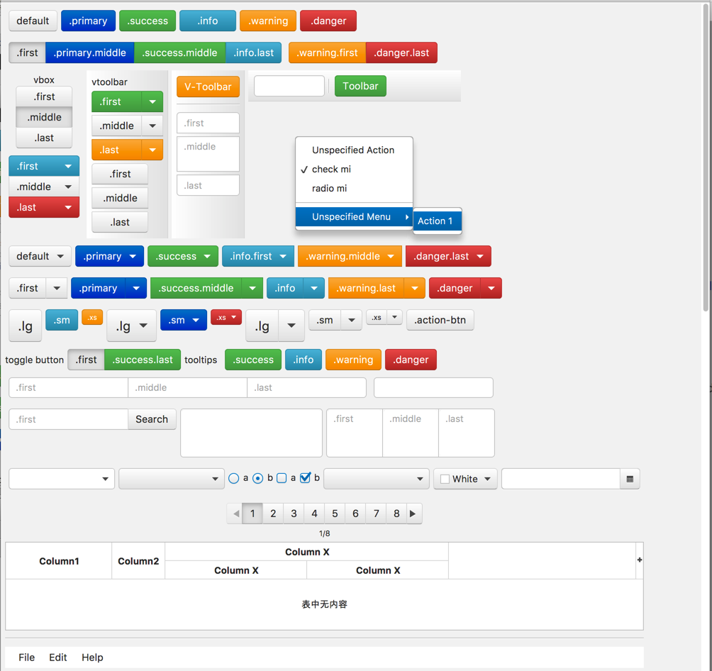
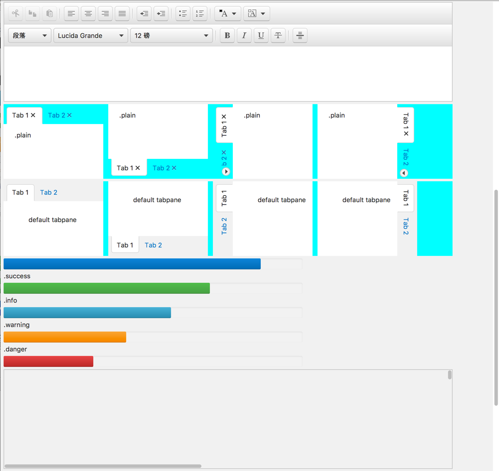
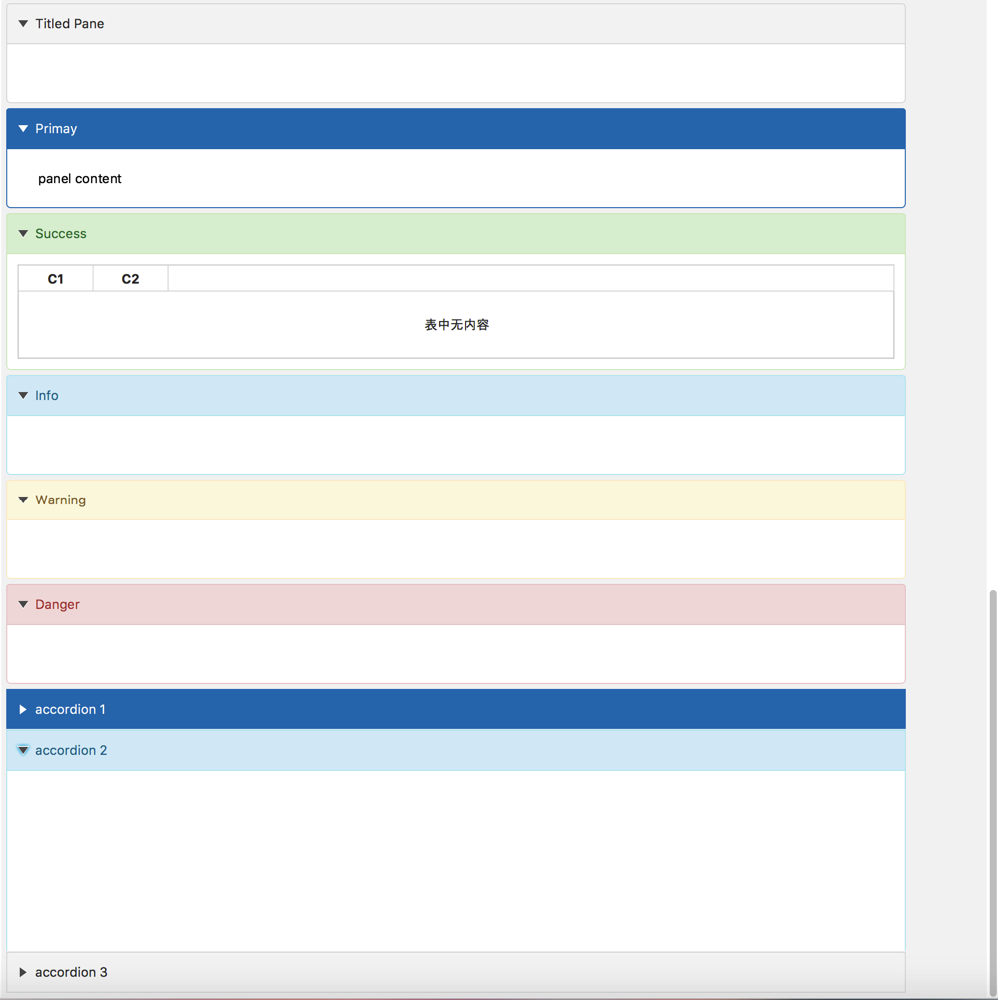

# jbootx
A JavaFx bootstrap theme.

Ever got annoyed with the default Modena theme of JavaFx8?

The bootstrap 3.x theme is quite beautiful right?

Don't worry, `jbootx` is what you are looking for, just take a simple look!

## Installation

jbootx is available on Maven Central:

```xml
<dependency>
    <groupId>io.github.dicolar</groupId>
    <artifactId>jbootx</artifactId>
    <version>1.0.0</version>
</dependency>
```

```kotlin
implementation("io.github.dicolar:jbootx:1.0.0")
```

The stylesheets sit at the root of the jar:

```java
scene.getStylesheets().add(MyApp.class.getResource("/bootstrap3.css").toExternalForm());
```

JavaFX itself is not pulled in, bring your own `javafx-controls` / `javafx-fxml`.

## Requirements
- Do not switch to the *`caspian`* theme!
- The Maven artifact needs `Java 21` and `JavaFX 21` or higher.
- Only need the theme on an older Java? Copy `bootstrap3.css` or `bootstrap2.css` from `src/main/resources` into your project, it works on `Java 8` and above.

## Bootstrap3




It's very easy to use cuz no java code is required! Simply add the `bootstrap3.css` file in your project.

```java
scene.getStylesheets().add(Main.class.getResource("bootstrap3.css").toExternalForm());
```

Open the `bootstrap3overview.fxml` in your `Scene Builder` and learn how to use it!


-------
**Good news! Bootstrap2 is also available!**




Add `bootstrap2.css` file to your project
```java
scene.getStylesheets().add(Main.class.getResource("bootstrap2.css").toExternalForm());
```

Open the `bootstrap2overview.fxml` in your `Scene Builder` and learn how to use it!

Enjoy!
